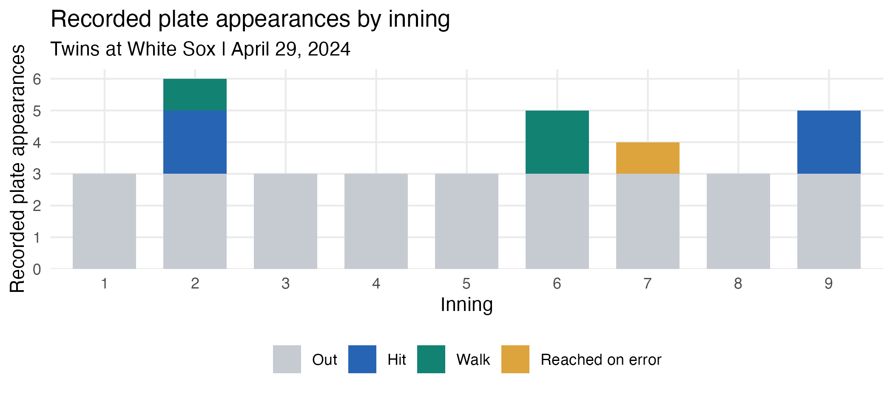

# MSDS 457 final project: daimondstats

Woohyun Kim's R package for personal scorebook analysis. The package is in
[`daimondstats/`](daimondstats/README.md); version 0.0.2 is work in progress.

## Current structure

```text
daimondstats/
  DESCRIPTION, NAMESPACE, LICENSE, README.md
  R/             # Four exported functions and dataset documentation
  man/           # Installed help
  data/          # Real scorecard data and a separate fictional demo
  data-raw/      # Source CSV and data preparation scripts
  inst/extdata/  # Demonstration export
  tests/         # Base-R assertion and error tests
analysis/        # Initial scorecard plot and its R script
module 5/        # Player-level batting chart and its R script
validation/      # Latest package check log
```

The four functions import scorecard CSVs, calculate batting statistics,
compare a personal game collection with a team season, and calculate RE24
from verified event states and a supplied expectancy matrix. The package
uses base R and requires R >= 4.1.0.

## Install and check

From the repository root:

```sh
R CMD INSTALL daimondstats
R CMD build daimondstats
R CMD check --no-manual daimondstats_0.0.2.tar.gz
```

The October 24, 2026 check on R 4.5.1 finished with status OK, including both
test scripts and examples. Network repository-index lookups were unavailable;
the PDF manual was not checked. See [the log](validation/R-CMD-check.log).

## Initial real-data analysis

The Week 4 dataset contains 35 Twins scorecard entries from April 29, 2024.
Four hits occur in innings 2 and 9, and five innings contain only outs.
This describes one recorded game and does not establish a season-wide pattern.
One flyout/lineout disagreement remains flagged; either label counts as an out
in this plot. The dataset does not contain the states needed for RE24.



Run `Rscript analysis/scorecard-outcomes.R` from the repository root to reproduce
the plot. This analysis script requires ggplot2; the package itself does not.
The source CSV permits rebuilding the packaged dataset. Extracting the original
app result additionally requires the saved source files described in the package.

The Module 5 update uses a [player-level batting chart](module%205/Kim_Module5_batting_stats.png)
and its [R script](module%205/Kim_Module5_batting_stats.R). It resolves the flagged
flyout/lineout in an analysis copy before calling `calculate_batting_stats()`;
the packaged dataset retains its original prediction and flag. Reproduce it
from the repository root with ggplot2 installed:

```sh
Rscript "module 5/Kim_Module5_batting_stats.R"
```

## Remaining work

Add complete real season and event data, document an appropriate expectancy
matrix, validate the analytical functions on official records, write a vignette,
and complete the final technical guide, nontechnical walkthroughs, and presentation.
Season-comparison and RE24 examples currently use fictional inputs.

AI assistance: An OpenAI assistant helped with implementation, tests,
documentation, the plot, and the progress update.
