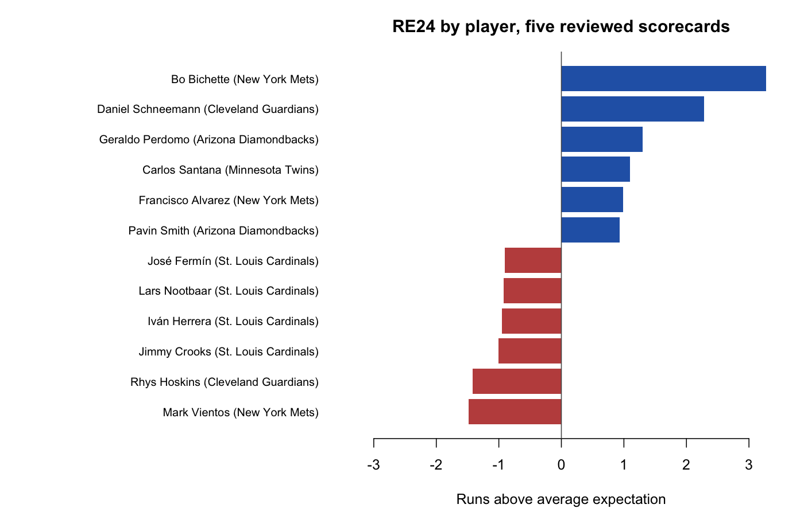

# MSDS 457 final project: daimondstats

Woohyun Kim's R package for personal scorebook analysis. The current package is
[daimondstats 0.0.4](daimondstats/README.md). The vignette
[From scorecard to run value](daimondstats/vignettes/from-scorecard-to-run-value.Rmd)
walks through the five reviewed scorecards from batting lines to RE24.

[Module 5 progress update, two-page PDF](module%205/Kim_Final_Project_Progress_Update_v2.pdf)

## Reviewed real-game collection

The new `reviewed_scorecards` dataset contains **179 plate appearances from five
team scorecards**, with 49 player/game combinations. Each included event was
matched uniquely to an independently downloaded MLB game feed. Counting totals
match the official box score for every included player and team. Ten exported
labels were normalized, with original values and correction notes preserved.

| Team | Date | PA | H | BB | HBP | OBP |
| --- | --- | ---: | ---: | ---: | ---: | ---: |
| Minnesota Twins | 2024-04-29 | 35 | 4 | 3 | 0 | .200 |
| New York Mets | 2026-04-11 | 41 | 10 | 4 | 0 | .341 |
| Arizona Diamondbacks | 2026-06-15 | 35 | 8 | 3 | 1 | .343 |
| Cleveland Guardians | 2026-06-17 | 33 | 3 | 3 | 0 | .182 |
| St. Louis Cardinals | 2026-07-31 | 35 | 5 | 3 | 0 | .229 |


This is a small convenience collection across teams and seasons. The chart
summarizes recorded games; it does not rank team strength or supply a complete
reference season. OBP uses pooled counts within each game. The original Twins
example remains available and overlaps the new collection.

## Run value (RE24) on real games

Version 0.0.4 adds `reviewed_base_out`: outs, occupied bases and runs for all
188 offensive events of the five reviewed team sides, rebuilt from MLB
play-by-play feeds. The 179 batting events join one to one with
`reviewed_scorecards`; nine steals, wild pitches, passed balls and pickoffs are
credited to the runner. Every row matches the feed's post-play state, and each
half-inning's runs match the official linescore. RE24 uses the published
FanGraphs matrix (`run_expectancy_fangraphs`, 4.15 runs per game).

| Team | Runs | RE24 |
| --- | ---: | ---: |
| New York Mets | 6 | 1.851 |
| Arizona Diamondbacks | 4 | 0.312 |
| Cleveland Guardians | 4 | -0.149 |
| Minnesota Twins | 3 | -1.149 |
| St. Louis Cardinals | 1 | -3.149 |



A team's RE24 for a game equals its runs minus 0.461 for each inning batted,
which the tests check. One matrix is applied to all games, and totals over a
few plate appearances are noisy.

## Structure and reproduction

```text
daimondstats/
  DESCRIPTION, NAMESPACE, LICENSE, README.md
  R/             # Five public functions and dataset documents
  man/           # Installed help
  data/          # Reviewed collection, base-out events, RE matrix, Twins example, demo
  data-raw/      # Source CSVs, audit, feed manifest, extraction/build scripts
  inst/extdata/  # Independent official game/player counting fixtures
  tests/         # Core, personal-season, reviewed-data, and real RE24 tests
  vignettes/     # From scorecard to run value
module 5/        # Updated chart, R script, numerical summary, progress PDF
analysis/        # RE24 plot and script; earlier Week 4 inning plot
validation/      # Package-check log and verification explanation
```

From the repository root:

```sh
R CMD build daimondstats
R CMD INSTALL daimondstats_0.0.4.tar.gz
R CMD check --no-manual daimondstats_0.0.4.tar.gz
Rscript analysis/re24_by_player.R
Rscript "module 5/Kim_Module5_batting_stats.R"
```

The chart script requires ggplot2; the package uses base R and requires R >= 4.1.0.
[Chart source](module%205/Kim_Module5_batting_stats.R) and
[numerical summary](module%205/Kim_Module5_game_summary.csv) are included.
Rebuild the reviewed R dataset from its included CSV by running
`Rscript data-raw/reviewed-scorecards.R` from the package root. The full source
verification additionally requires the saved app results and downloaded feeds.
`python3 data-raw/base-out-states.py FEED_DIR` rebuilds the base-out CSV from
downloaded feeds; [their hashes](daimondstats/data-raw/base-out-manifest.json)
are recorded.

## Verification and package checks

The audit inspected 155 saved result files, including multi-card children:
184 component cards, of which eleven had stored event references. Five passed
complete event coverage, card review, and live MLB counting-total checks.
Incomplete cards, extra detections, duplicate processing and unresolved scoring
conflicts were excluded. Source exports may already contain contextual
corrections; agreement is not an independent classifier-accuracy estimate.

- [Audit decisions](daimondstats/data-raw/scorecard-audit.csv)
- [Source and feed manifest with SHA-256 hashes](daimondstats/data-raw/verification-manifest.json)
- [Verification explanation](validation/README.md)
- [Official game totals](daimondstats/inst/extdata/reviewed_game_totals.csv)
- [Official player totals](daimondstats/inst/extdata/reviewed_player_totals.csv)

The November 8, 2026 `R CMD check --no-manual` of version 0.0.4 on R 4.5.1
finished with **status OK**, including examples, all four test scripts and the
vignette rebuild.
[Check log](validation/R-CMD-check.log). Repository-index access was unavailable;
PDF manual generation was not checked.

## Remaining work

Connect `compare_personal_season()` to a complete real team schedule, since
its example still uses fictional games, and finish the technical documentation,
nontechnical walkthroughs, and presentation.

AI assistance: An OpenAI assistant helped with implementation, verification,
tests, documentation, the chart, and the progress update. Claude helped with the
version 0.0.4 base-out data, RE24 plot, vignette, and tests.
